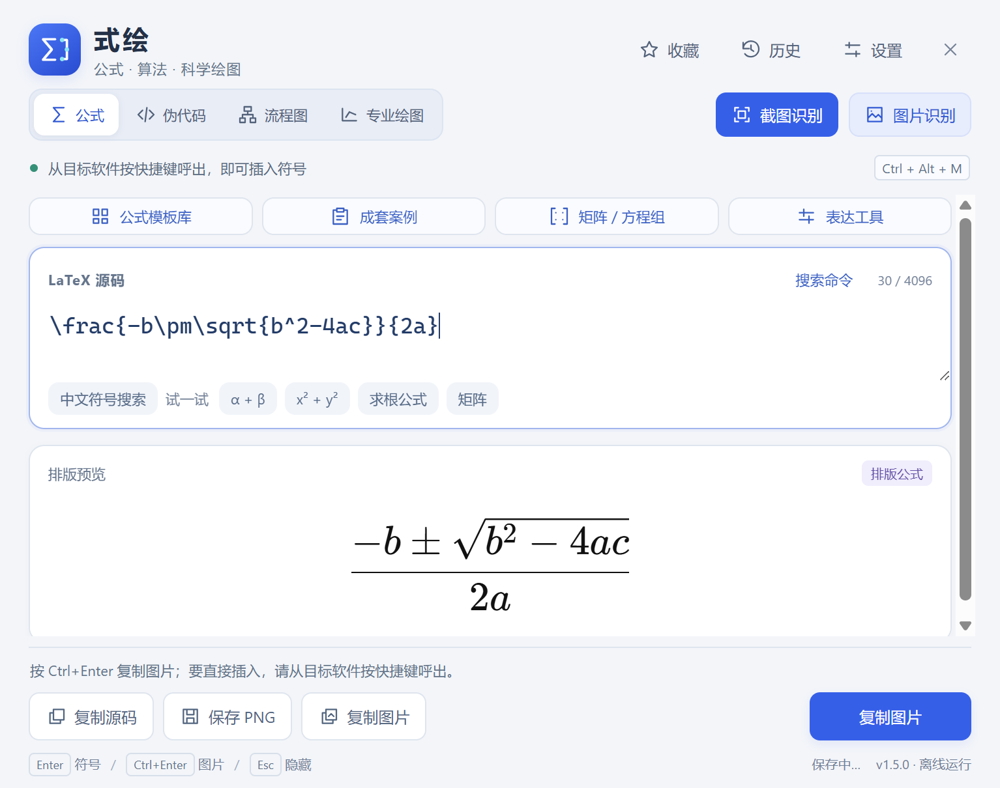

# 式绘 · ShiHui

[](https://github.com/Enternity-Heng/shihui/actions/workflows/ci.yml)

**Windows 上的离线公式、算法与科学绘图工作台。**

将简单 LaTeX 转为可编辑的文字符号，将复杂公式排版为图片；从截图识别公式，在同一个工作台编写伪代码、绘制流程图和专业示意图。面向课堂笔记、课程作业、教学讲义与日常科研表达，也可通过符号输入和公式图片粘贴，在 **微信、QQ 等 Windows 桌面聊天软件**中交流数学内容。

**不熟悉 LaTeX 也能从模板上手：选学科、找模板、填变量、看预览，再复制图片。** 适合作为家教备课、线上讲题和课后答疑的表达辅助工具。

**当前版本：1.5.0 · Windows x64 · MIT**

[完整使用手册](docs/使用手册.md) · [版本与下载](https://github.com/Enternity-Heng/shihui/releases) · [问题反馈](https://github.com/Enternity-Heng/shihui/issues) · [参与开发](CONTRIBUTING.md)



## 能做什么

| 工作场景 | 功能 |
| --- | --- |
| 公式输入 | LaTeX 实时预览、Unicode 符号转换、复杂公式图片插入与 PNG 导出 |
| 模板入门 | 点选现成公式并填写变量，矩阵与方程组按表格填写；可先使用常用模板，再逐步学习 LaTeX |
| 家教与辅导 | 课前整理例题和讲义，课中展示推导与示意图，课后分享公式图片并答疑 |
| 聊天交流 | 在微信、QQ 等 Windows 客户端中快捷呼出，输入数学符号或粘贴公式图片，适合讨论作业、答疑和分享推导 |
| 图片识别 | 截图、图片文件与剪贴板图片转 LaTeX，离线推理，原图对照后确认应用 |
| 专业公式 | 九个学科模块、235 个独立模板，按专业、主题和中英文关键词筛选 |
| 成套案例 | 27 套教学案例，提供已知量、条件、推导、结论和方法来源 |
| 表达工具 | 矩阵、方程组、数值与单位、科学记数法、多行推导、分段函数、化学表达式 |
| 算法与绘图 | 中文伪代码、通用流程图、控制框图、质点受力图、遗传杂交图 |
| 日常复用 | 自定义命令、联动占位符、命名收藏与分类、备份导入导出、本机历史与草稿恢复 |

## 适用学科与教学场景

九个专业模块覆盖 **数学、物理、计算机、电子信息与自动化、统计学、机械／土木／工程力学、化学／化工／材料、经济学／管理学和生物学**。共享模板按稳定 ID 去重，支持按学科、主题与基础／进阶筛选。

从中学数理化生的公式讲解，到大学专业课的笔记与讲义整理，都可以使用对应的公式排版和图示功能。例如：数学中的分数、矩阵与多行推导，物理中的受力图，化学中的反应式，以及生物中的遗传杂交图。

### 家教、线上辅导与课后答疑

- **课前备课**：从模板和教学案例中选取合适的表达，整理例题、推导与讲义；常用公式可收藏复用。
- **课中讲解**：填写变量、预览公式，使用受力图、遗传杂交图或流程图辅助说明思路，按需复制或导出图片。
- **课后答疑**：把排版好的公式或示意图作为图片，通过微信、QQ 等聊天软件发给学生，方便回看与继续讨论。

式绘提供输入、排版和图示辅助；教学案例是固定示范，修改数值不会自动重算，讲解内容与识别结果仍需使用者核对。

应用运行时无需联网，识别由本机 CPU 执行，源码、收藏、历史和草稿保存在本机。首次安装开发依赖和下载模型需要联网。

## 快速使用

成品发布位置为 [GitHub Releases](https://github.com/Enternity-Heng/shihui/releases)；若尚无发行附件，请按下方说明从源码构建。

- **安装版**：运行 `式绘-1.5.0-Setup-x64.exe`，默认安装给当前用户。
- **解压版**：完整解压 `式绘-1.5.0-Windows-x64.zip`，启动 `MathInputAssistant.exe`；保留同目录的 DLL、resources 和 locales。
- 使用成品无需安装 Node.js、Python 或 LaTeX。未配置代码签名证书的构建为未签名版本。

### 不熟悉 LaTeX：先从模板开始

1. 打开“公式模板库”，按学科、主题或中英文关键词找到需要的公式。
2. 点击“插入并填写”，在选中的占位位置填写变量，用 **Tab／Shift + Tab** 切换填写位置。
3. 查看实时预览，点击“复制图片”或“保存 PNG”，用于聊天、笔记或讲义。

矩阵与方程组可通过“矩阵／方程组”面板按表格填写；单位、分段函数、多行推导和化学表达式可从“表达工具”进入填写器。现成公式可通过截图或图片识别，核对后复用。这些常用操作可以先从点选与填写开始，不必先记住整套 LaTeX 命令。

### 快捷键与源码输入

1. 启动式绘，在目标软件内点击输入位置。
2. 按 **Ctrl + Alt + M** 呼出工作台，输入 `\alpha+\beta`，按 Enter 插入 `α+β`。
3. 输入 `\frac{-b\pm\sqrt{b^2-4ac}}{2a}`，按 **Ctrl + Enter** 插入公式图片；没有外部目标时复制图片。
4. 按 **Ctrl + Alt + S** 框选公式截图，识别后对照原图核对，再确认应用。

| 快捷键 | 操作 |
| --- | --- |
| Ctrl + Alt + M | 呼出公式输入窗口 |
| Ctrl + Alt + S | 框选截图识别 |
| Enter | 插入可转换的文字符号 |
| Ctrl + Enter | 插入或复制公式图片 |
| Ctrl + Shift + V | 读取剪贴板图片进行识别 |
| Esc | 关闭当前面板或隐藏窗口 |

### 在微信、QQ 等聊天软件中使用

无需给聊天软件安装插件，也不要求对方安装式绘。简单公式以普通文字符号交流，分数、根式、矩阵等复杂公式以图片分享。

1. 打开微信或 QQ 的 Windows 客户端，先点击需要输入的聊天输入框。
2. 按 **Ctrl + Alt + M** 呼出式绘，输入 `\alpha+\beta` 或 `x^2+y^2`，按 Enter 将 `α+β` 或 `x²+y²` 插入原输入框。
3. 对于 `\frac{1}{2}` 等复杂公式，按 **Ctrl + Enter** 或点击“插入图片”，向原聊天窗口粘贴公式图片。也可点击“复制图片”，回到聊天窗口按 **Ctrl + V** 手动粘贴，或保存 PNG 后作为图片发送。
4. 回到聊天窗口检查内容，再自行确认发送。式绘只负责输入或粘贴，不主动按下聊天软件的发送键。

不同客户端版本对模拟输入和图片粘贴的支持可能不同；微信、QQ 尚未纳入本项目的专项实机兼容性验收。不能自动插入时，可重新点击输入框后呼出，或改用手动粘贴／发送 PNG。聊天软件不会因此获得原生 LaTeX 编辑能力，收到的复杂公式是图片。

## 从源码运行

需要 **Windows x64、Node.js 24 和 npm**。项目包含 Windows 原生接口，不承诺 macOS、Linux 或 Windows ARM 原生运行。

```powershell
git clone https://github.com/Enternity-Heng/shihui.git
cd shihui
npm ci
npm run setup
npm test
npm run build
npm start
```

`npm run setup` 准备 Electron，并从 `RapidAI/RapidLaTeXOCR` 的固定版本下载缺失的 OCR 权重，按 `assets/ocr/manifest.json` 中的 SHA-256 校验。仅需补齐模型时运行 `npm run setup:ocr`。应用内不下载模型。

为保持仓库轻量，Git 不包含约 171 MiB 的 ONNX 权重；保留下载清单、分词器和许可证。构建所需的 Windows 应用目录运行 DLL 及校验清单保留在 `assets/vcruntime/`，按微软随附许可分发。

### 检查与打包

```powershell
npm test                 # 单元测试
npm run build            # 类型、模型和原生依赖检查，并构建应用
npm run test:desktop     # 桌面交互测试
npm run test:ocr         # 实际离线识别
npm run test:professional
npm run test:expression
npm run test:specialty
npm run test:ui
npm run package          # 生成 Windows 安装版、解压版和完整源码包
```

桌面测试会打开测试窗口并使用系统剪贴板，运行期间请勿操作键盘鼠标。测试使用隔离配置，结果写入 `.test-profile/` 与 `test-results/`。其他兼容性、安装生命周期和恢复测试见使用手册。

打包结果位于 `release/`，含安装包、解压包、包含模型的完整源码 ZIP、许可证与 SHA-256 清单。首次打包需要下载 NSIS 等构建工具。GitHub 自动检查在 Windows 上执行类型检查与单元测试，不代表完整桌面兼容性验收。

## 项目结构

```text
src/main/       Electron 主进程、Windows 接口、离线识别与存储
src/renderer/   编辑界面、预览与导出
src/core/       公式转换、模板、案例、表达与图示逻辑
src/shared/     主进程与界面的共享类型
assets/         图标、模型清单、第三方许可与 Windows 运行组件
scripts/        资源准备、构建、测试、打包与发布审计
tests/          单元测试和公开来源的识别样例
docs/           完整手册、专业模块说明与界面截图
```

依赖、构建目录、安装成品、识别权重、测试产物、隔离用户配置及本机密钥文件均已从 Git 排除。

## 支持范围

- 公式语法以 KaTeX 支持范围为准，不编译完整 LaTeX 文档。
- Unicode 上下标仅在可完整表示时转换；复杂公式以图片保留排版。
- 图片粘贴依赖目标软件支持；导出的图片不是 Word 可编辑公式对象。
- OCR 结果需要人工核对，尤其是分数、根号、上下标和相似字符。
- 教学案例为固定示范，改数后不自动重算；伪代码不执行算法，图示不进行工程或生物学判断。

## 文档与来源

- [完整使用手册与历史版本说明](docs/使用手册.md)
- [专业模块说明](docs/专业模块说明.md)
- [四专业扩展说明](docs/四专业扩展说明.md)
- [表达工具与流程图说明](docs/表达工具与流程图说明.md)
- [成套案例与专业绘图说明](docs/成套案例与专业绘图说明.md)
- [已有版本验证记录](VALIDATION.md)：历史验收及其环境限制；部分原始报告位于本地测试产物目录，不随 Git 上传。

## 许可证与致谢

项目代码采用 [MIT License](LICENSE)。感谢 Electron、KaTeX／mhchem、RapidLaTeXOCR／LaTeX-OCR、ONNX Runtime 和 Koffi。模型、依赖及 Windows 运行组件遵循各自许可证，详见 [第三方声明](THIRD-PARTY-NOTICES.txt)、`assets/ocr/`、`assets/licenses/` 和 `assets/vcruntime/`。

---

ShiHui is an offline Windows workspace for LaTeX formula input, screenshot-to-LaTeX OCR, pseudocode, flowcharts and scientific diagrams. Runtime inference stays on your computer. Chinese documentation is included.
